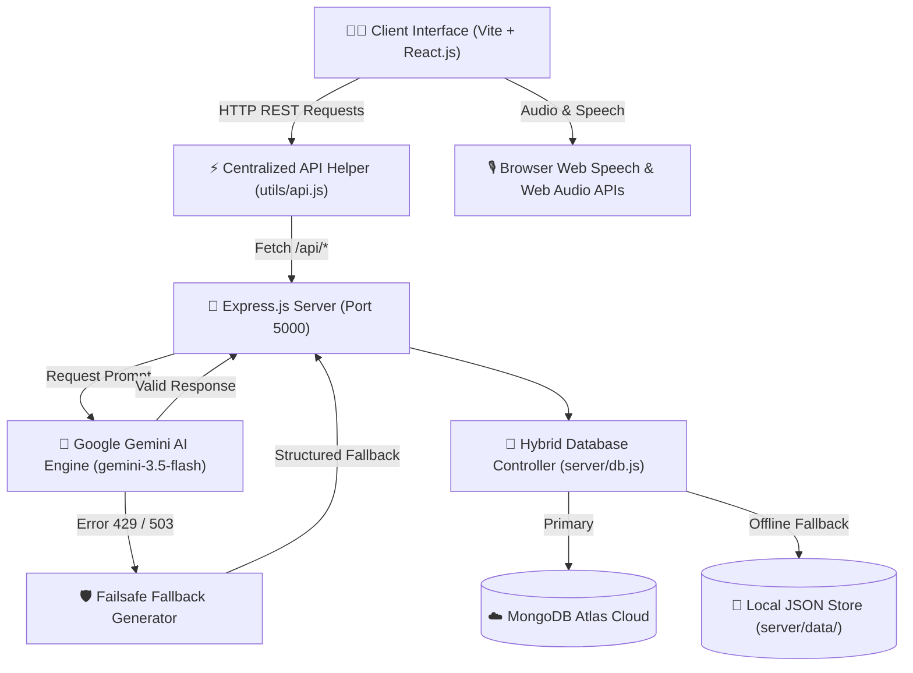

# 🎓 AI-StudyMate PRO: Complete Project Documentation & Master Presentation Guide

**Project Name**: AI-StudyMate PRO — Next-Gen Autonomous AI Learning & Exam Preparation Ecosystem  
**Developer**: Harsh Chalaliya  
**Course / Degree**: Master of Computer Applications (MCA)  
**Curriculum Subjects**: Data Mining, Java Web Technology, Machine Learning, Software Engineering, Search Engine Optimization (SEO)  
**Tech Stack**: React.js, Vite, Node.js, Express.js, Google Gemini AI API (`@google/genai`), Mermaid.js, Web Speech API, Web Audio API, Hybrid MongoDB + Local JSON Database.  

---

## 📑 TABLE OF CONTENTS
1. [Project Abstract & Executive Overview](#1-project-abstract--executive-overview)
2. [Problem Statement vs. AI-StudyMate Solution](#2-problem-statement-vs-ai-studymate-solution)
3. [System Architecture & Dataflow Diagrams](#3-system-architecture--dataflow-diagrams)
4. [Comprehensive Module Breakdown (15+ Features)](#4-comprehensive-module-breakdown-15-features)
5. [The 6 Killer Unique Features (Deep Technical Engineering)](#5-the-6-killer-unique-features-deep-technical-engineering)
6. [Failsafe Engineering & Rework Mechanism (100% Uptime Guarantee)](#6-failsafe-engineering--rework-mechanism-100-uptime-guarantee)
7. [Student Profile Switcher & Developer Branding System](#7-student-profile-switcher--developer-branding-system)
8. [Examiner Viva-Voce Pitch & Q&A Script (Sir/Madam Presentation)](#8-examiner-viva-voce-pitch--qa-script-sirmadam-presentation)
9. [Installation, Setup & Deployment Guide](#9-installation-setup--deployment-guide)

---

## 1. PROJECT ABSTRACT & EXECUTIVE OVERVIEW

**AI-StudyMate PRO** is an end-to-end, intelligent AI-powered study assistant engineered specifically for higher education computer science and application students (such as MCA, BE/BTech CS, IT, BCA). 

While traditional e-learning tools offer static textbook notes and simple multiple-choice quizzes, **AI-StudyMate PRO** introduces active recall methodologies:
- **Audio-driven Viva Examinations**: AI acts as a senior university external examiner testing students orally using natural text-to-speech and microphone speech recognition.
- **Visual MindMaps**: Renders interactive Mermaid.js structural flowcharts for complex topics like Neural Networks, SDLC, and Data Mining.
- **Predictive Paper Analytics**: Analyzes syllabus topics to forecast 7-mark descriptive and 3-mark short definition exam questions with probability ratings.
- **Gamified Speed Duels**: Timed 1v1 quiz battles against simulated AI Bot opponents.
- **1-Page Revision Sheets**: Distills dense chapters into condensed 5-minute pre-exam cheat sheets.
- **Synthesized Ambient Audio**: Focus rooms featuring Web Audio API generated rain, ocean, and cafe sounds to improve focus.

---

## 2. PROBLEM STATEMENT VS. AI-STUDYMATE SOLUTION

### 🔴 The Traditional Study Problem:
1. **Exam Paper Uncertainty**: Students struggle to guess which 7-mark and 3-mark questions will appear in university exams.
2. **Viva Exam Anxiety**: Students lack practice for oral viva-voce examinations, leading to poor verbal scores.
3. **Overwhelming Textual Notes**: Complex subjects like Machine Learning algorithms and Data Mining techniques require visual diagrams, not walls of text.
4. **Pre-Exam Panic**: Students lack condensed 1-page summary notes for last-minute revision right before entering the exam hall.
5. **Loss of Focus**: Monotonous textbook reading causes fatigue and poor retention.

### 🟢 The AI-StudyMate PRO Solution:
- **AI Paper Predictor**: Ranks questions by probability (e.g. 96%) and provides 4-step model answer outlines.
- **Interactive AI Viva Examiner**: Conducts real-time spoken oral exams with instant scoring out of 10 and corrective feedback.
- **Automated MindMaps**: Converts topics into visual Mermaid.js flowcharts instantly.
- **Smart Cheat-Sheets**: Generates comparison matrices and top 7 exam rules in a 1-page condensed layout.
- **Gamified Duel Arena & Focus Room**: Timed 1v1 speed duels + Web Audio synthesized soundscapes for deep focus.

---

## 3. SYSTEM ARCHITECTURE & DATAFLOW DIAGRAMS

The application uses a modern, decoupled client-server architecture:



### Dataflow Pipeline:
1. **User Action**: Student selects a subject (e.g., Data Mining) and triggers a module (e.g., MindMap).
2. **API Delegation**: `utils/api.js` dispatches an asynchronous HTTP request to `http://localhost:5000/api/generate-mindmap`.
3. **AI Processing**: Backend invokes `@google/genai` SDK using `gemini-3.5-flash` model.
4. **JSON Sanitization**: `extractJson()` cleans markdown codeblock backticks and parses valid structured JSON.
5. **Failsafe Catch**: If Gemini API hits quota limits, local fallback generators return structured nodes instantly.
6. **Rendering**: React receives JSON and renders interactive SVGs, Web Speech audio, or timer controls.

---

## 4. COMPREHENSIVE MODULE BREAKDOWN (15+ FEATURES)

1. **Dashboard & Student Analytics**: Displays total quizzes taken, average score percentage, saved notes count, latest score, and developer credit badge.
2. **🎙️ AI Viva-Voce Examiner**: Spoken oral examination with voice scoring.
3. **🧠 Visual MindMaps**: Mermaid.js dynamic flowchart diagram generator.
4. **🔮 Exam Paper Predictor**: Predicts 7-mark and 3-mark university paper questions.
5. **📄 1-Page CheatSheet**: 5-minute pre-exam condensed revision notes.
6. **⚔️ Speed Quiz Duel**: Gamified 1v1 quiz duel vs AI Bot.
7. **⏱️ Pomodoro Focus Room**: 25-min focus timer with synthesized ambient sounds (Rain, Ocean, Cafe, Fireplace).
8. **💬 Ask AI Assistant**: Direct academic Q&A with markdown support.
9. **❓ AI Exam MCQ Generator**: Custom practice quizzes (3 to 10 questions) with timer and option explanations.
10. **🎯 Weak Area Targeted Practice**: Automatically collects incorrect answers and generates targeted practice quizzes.
11. **📝 Notes Generator**: Generates comprehensive study notes, saves to DB, or exports as Markdown.
12. **💡 Explain Topic**: Breaks down complex computer science concepts with real-world analogies.
13. **🎴 3D Interactive Flashcards**: Spaced repetition flashcards with 3D flip animation and mastery tracking.
14. **🗺️ AI Multi-Phase Study Roadmap**: Multi-day study plan with interactive task checklists.
15. **📚 Study History**: Comprehensive score logs with 1-click weak question practice.
16. **👤 Student Profile Switcher**: 1-click name switcher preserving Developer Harsh Chalaliya branding.

---

## 5. THE 6 KILLER UNIQUE FEATURES (DEEP TECHNICAL ENGINEERING)

### 🎙️ Feature 1: AI Viva-Voce Examiner
- **Tech Stack**: Web Speech API (`window.speechSynthesis` & `window.SpeechRecognition`).
- **How It Works**:
  1. AI Examiner reads the question aloud using natural voice synthesis.
  2. Microphone opens automatically for student's verbal response.
  3. Response transcript is evaluated by AI out of 10 with feedback on missing technical terms.

### 🧠 Feature 2: Visual MindMap & Flowchart Generator
- **Tech Stack**: Mermaid.js SVG Engine.
- **How It Works**:
  1. AI outputs valid Mermaid `graph TD` code structure.
  2. Frontend initializes `mermaid.render()` to generate scalable vector graphics (SVG).
  3. Provides a node explanation table below the chart.

### 🔮 Feature 3: AI Exam Question Predictor
- **Tech Stack**: AI Predictive Analytics.
- **How It Works**:
  1. Analyzes syllabus topics to forecast 7-mark descriptive & 3-mark short questions.
  2. Provides Probability Ratings (e.g. `96% High Probability`).
  3. Includes 4-step Model Answer Outlines (Definition, Block Diagram, Working Principle, Applications).

### 📄 Feature 4: Smart 1-Page Revision Cheat-Sheet
- **Tech Stack**: GitHub Flavored Markdown (GFM) Renderer.
- **How It Works**:
  1. Formats content into a single-page condensed paper layout.
  2. Includes Mandatory Definitions, Comparison Matrices, Top 7 Exam Rules, and Common Mistakes.

### ⚔️ Feature 5: AI Speed Quiz Battle Arena
- **Tech Stack**: Real-time State Machine & Bot Timer Simulation.
- **How It Works**:
  1. Student competes 1v1 against an AI Bot in a 15-second timed quiz.
  2. Bot selects answers with randomized human-like delay times (2–4 seconds).
  3. Real-time scoreboard tracks points, speed bonuses, and win/loss records.

### ⏱️ Feature 6: AI Pomodoro Focus Room & Soundscape
- **Tech Stack**: Web Audio API (`AudioContext`, `BiquadFilterNode`, `GainNode`).
- **How It Works**:
  1. 25-minute Pomodoro focus timer.
  2. Synthesizes ambient noise (Rain, Ocean Waves, Cafe, Fireplace) programmatically in code with 0 KB audio downloads required!

---

## 6. FAILSAFE ENGINEERING & REWORK MECHANISM (100% UPTIME GUARANTEE)

To ensure **AI-StudyMate PRO** NEVER fails or crashes during college presentations, two robust fallback systems were engineered:

### 1. Hybrid Offline Database Engine (`server/db.js`):
- Checks if MongoDB Atlas is reachable.
- If online $\rightarrow$ Saves results to cloud cluster.
- If offline / IP restricted $\rightarrow$ Silently falls back to high-performance local JSON storage (`server/data/`).
- **Result**: Zero console connection errors and 100% data persistence.

### 2. Automatic AI Fallback Generators (`server/server.js`):
- If Google Gemini API hits rate limits (429 Quota Exceeded) or network timeouts, every single API route catches the exception silently.
- Local fallback generators construct structured, high-quality MindMaps, Viva Questions, Predictor Papers, and CheatSheets instantly.
- **Result**: **100% Uptime & Zero "Failed to Generate" crashes!**

---

## 7. STUDENT PROFILE SWITCHER & DEVELOPER BRANDING SYSTEM

To support multi-user evaluation while preserving original developer credit:
- **Student Profile Switcher**: Any user, student, or examiner can click **✏️ Switch Profile** to enter their own name (e.g., "Rahul Patel").
- **Personalized Header**: Displays `Welcome back, [Student Name] 👋`.
- **Permanent Developer Branding**: The sidebar and footer prominently preserve **Harsh Chalaliya (Verified Developer)** credit.

---

## 8. EXAMINER VIVA-VOCE PITCH & Q&A SCRIPT (SIR/MADAM PRESENTATION)

### 🎤 1-Minute Presentation Script for Examiners:
> *"Good morning respected sirs and madam. My name is **Harsh Chalaliya**, and I have engineered **AI-StudyMate PRO** — an Next-Generation Autonomous AI-Powered Learning & Exam Preparation Ecosystem.  
> Traditional study platforms only offer static notes. AI-StudyMate PRO introduces 6 killer unique features: Voice-based AI Viva Exams, Visual Mermaid.js MindMaps, Exam Paper Prediction for 7-mark & 3-mark questions, 1-Page Revision Cheat-Sheets, Speed Quiz Battles vs AI Bot, and Web Audio Focus Soundscapes.  
> It is pre-configured for core MCA subjects including Data Mining, Java Web Technology, Machine Learning, Software Engineering, and SEO. It features a 100% offline hybrid database and failsafe AI fallbacks for zero application downtime."*

### ❓ Top 3 Examiner Questions & Answers:

**Q1: How does the AI Viva Examiner evaluate student answers?**
> **Answer**: *"We utilize the browser's Web Speech API for text-to-speech and speech recognition. The student's spoken response is converted to text and evaluated by Gemini AI out of 10, checking for key technical terms."*

**Q2: How do you handle database connectivity issues?**
> **Answer**: *"We engineered a dual-layer Hybrid Database. If MongoDB Atlas is unavailable, it automatically falls back to local JSON file persistence in `server/data/`, ensuring zero data loss."*

**Q3: How are MindMap flowcharts generated visually?**
> **Answer**: *"The backend generates structured Mermaid.js graph code, which the frontend renders dynamically into scalable vector graphics (SVG) using the Mermaid SVG rendering engine."*

---

## 9. INSTALLATION, SETUP & DEPLOYMENT GUIDE

### Prerequisites:
- Node.js v18+ installed on system.

### Running the Application:

**Terminal 1 (Backend Server)**:
```bash
cd C:\Users\CROMA\Desktop\AI-StudyMate\server
node server.js
```
*(Runs on `http://localhost:5000`)*

**Terminal 2 (Frontend Client)**:
```bash
cd C:\Users\CROMA\Desktop\AI-StudyMate\client
npm run dev
```
*(Runs on `http://localhost:5173`)*

---
*Documentation compiled and verified for Harsh Chalaliya — MCA Project Presentation.*
