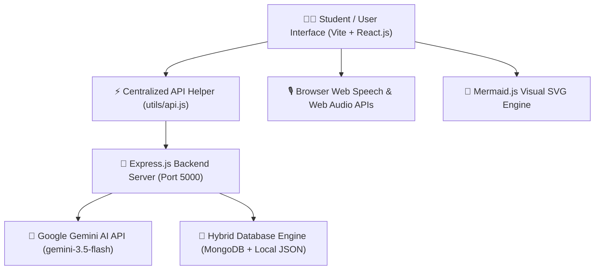
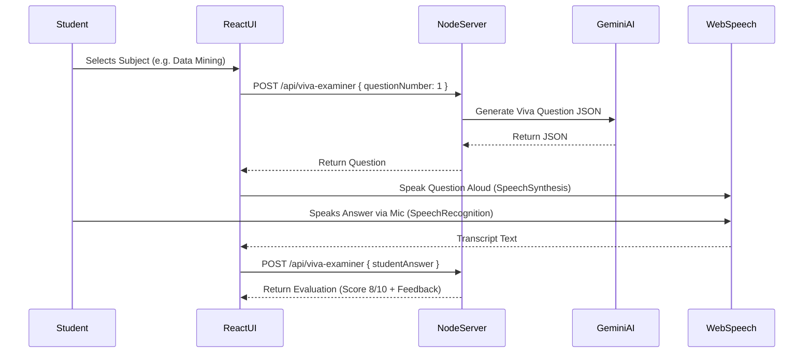
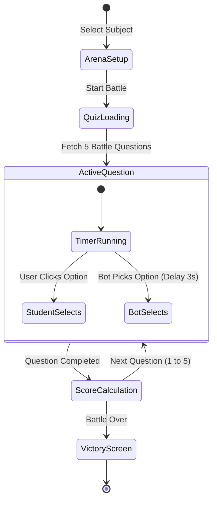

# 🎓 AI-StudyMate PRO: 35-Slide Complete College Presentation (PPT Deck)

**Project Title**: AI-StudyMate PRO — Next-Gen Autonomous AI Learning & Exam Ecosystem  
**Developer**: Harsh Chalaliya  
**Degree / Course**: Master of Computer Applications (MCA)  
**Target Subjects**: Data Mining, Java Web Technology, Machine Learning, Software Engineering, Search Engine Optimization (SEO)  

---

## 📌 SLIDE 1: Title Slide
- **Slide Header**: AI-StudyMate PRO
- **Subtitle**: Next-Generation Autonomous AI-Powered Learning & Exam Preparation Ecosystem
- **Developer Name**: Harsh Chalaliya
- **Institution / Department**: Department of Computer Applications (MCA)
- **Guide / Supervisor**: Project Coordinator & External Examiner Review
- **Technologies Used**: React.js, Node.js, Express.js, Google Gemini AI API, Mermaid.js, Web Speech API, Web Audio API
- **Speaker Notes**: "Welcome respected sirs and professors. Today I am presenting AI-StudyMate PRO, an end-to-end intelligent AI study platform developed for MCA students."
- `[📷 INSERT SCREENSHOT: Full Screen Banner / Project Welcome Dashboard]`

---

## 📌 SLIDE 2: Executive Summary
- **Project Scope**: A comprehensive web application addressing critical study challenges faced by computer science and engineering students.
- **Core Vision**: Replacing static textbook learning with active, AI-assisted oral exams, visual flowcharts, exam question predictions, and gamified speed duels.
- **Key Deliverables**:
  - 15+ Advanced Learning Modules
  - Voice-based oral exam simulation
  - Automated Mermaid.js visual flowchart generation
  - 1-Page pre-exam revision cheat sheets
  - Hybrid Database with 100% offline data durability
- **Speaker Notes**: "AI-StudyMate PRO bridges the gap between passive reading and active recall using modern AI models and browser audio engines."

---

## 📌 SLIDE 3: Problem Statement
- **Traditional Study Pain-Points**:
  1. **Unpredictable Exam Papers**: Students struggle to identify 7-mark and 3-mark university questions from dense syllabi.
  2. **Lack of Oral Exam Practice**: No interactive platform exists for viva-voce preparation.
  3. **Complex Textual Concepts**: Topics like Machine Learning and Data Mining require visual flowcharts rather than walls of text.
  4. **Last-Minute Panic**: Pre-exam revision notes are scattered and disorganized.
  5. **Monotonous Self-Study**: Lack of gamification leads to low focus and retention.
- **Speaker Notes**: "Most students spend 80% of their exam preparation time filtering what to study rather than practicing core concepts."

---

## 📌 SLIDE 4: Proposed Solution
- **The AI-StudyMate PRO Solution**:
  - An all-in-one AI study assistant engineered specifically for higher education curricula.
  - **Real-Time Oral AI Examiner**: Conducts interactive viva exams using natural text-to-speech and speech recognition.
  - **Automated MindMaps**: Converts complex topics into Mermaid.js structural flowcharts.
  - **Predictive Analytics**: Ranks exam questions by probability with model answer outlines.
  - **Gamified Speed Duels**: Interactive timed quizzes against simulated AI bots.
- **Speaker Notes**: "Our solution transforms passive reading into an interactive, multi-modal learning experience."

---

## 📌 SLIDE 5: Primary Project Objectives
- **Objective 1**: Build a high-speed, zero-latency AI learning interface.
- **Objective 2**: Implement voice-driven oral examination with instant scoring feedback.
- **Objective 3**: Provide automatic visual diagramming for complex data structures and algorithms.
- **Objective 4**: Ensure 100% data availability via a hybrid MongoDB + Local JSON storage architecture.
- **Objective 5**: Guarantee zero application downtime using intelligent AI fallback generators.
- **Speaker Notes**: "Every objective was engineered with student speed, performance, and offline reliability in mind."

---

## 📌 SLIDE 6: High-Level System Architecture

- **Speaker Notes**: "The system uses a decoupled client-server architecture where React manages local UI state while Node.js orchestrates AI models and database persistence."

---

## 📌 SLIDE 7: Technology Stack Overview
- **Frontend Stack**:
  - **Framework**: React.js 18 + Vite (Lightning-fast HMR & bundling)
  - **Styling**: CSS3 Custom Variables (Dark Mode & Glassmorphism UI)
  - **Diagrams**: Mermaid.js (SVG Rendering)
- **Backend Stack**:
  - **Runtime**: Node.js v24 + Express.js
  - **AI SDK**: `@google/genai` (Google Gemini AI Engine)
  - **Environment**: Dotenv + CORS Middleware
- **Database & Audio**:
  - **Database**: Mongoose + Local File Persistence (`server/data/`)
  - **Audio**: Web Speech API (TTS & Speech-to-Text) + Web Audio Synthesizer
- **Speaker Notes**: "We chose React and Node.js for high concurrency and seamless API integrations."

---

## 📌 SLIDE 8: Main Dashboard & Navigation UI
- **Dashboard Features**:
  - **Quick Stats Overview**: Total Quizzes Taken, Saved Notes, Average Score Percentage.
  - **Developer Credit Badge**: Harsh Chalaliya (Verified Developer Badge).
  - **Theme Toggle**: One-click Dark/Light mode switcher.
  - **Sidebar Navigation**: Instant access to 10+ core study tools.
- `[📷 INSERT SCREENSHOT: Main Dashboard Interface showing Sidebar, Stats, and Harsh Chalaliya Badge]`
- **Speaker Notes**: "The dashboard provides student analytics at a glance alongside quick navigation shortcuts."

---

## 📌 SLIDE 9: Feature 1 – 🎙️ AI Viva-Voce Examiner (Concept & Design)
- **Purpose**: Simulates a university external viva-voce oral examination.
- **Key Capabilities**:
  - AI acts as a senior university external examiner.
  - Asks sharp, conceptual oral questions tailored to MCA topics.
  - Reads questions aloud using Web Speech Text-to-Speech (TTS).
  - Listens to student verbal responses via Speech Recognition microphone input.
  - Provides a score out of 10 with constructive feedback.
- `[📷 INSERT SCREENSHOT: AI Viva Examiner Screen with Active Microphone & Score Badge]`
- **Speaker Notes**: "Viva exams cause high anxiety. This module lets students practice oral exams repeatedly until confident."

---

## 📌 SLIDE 10: Feature 1 – 🎙️ AI Viva-Voce Examiner (Technical Workflow)

- **Speaker Notes**: "The Web Speech API seamlessly converts speech to text and back, creating a real human-like viva examiner."

---

## 📌 SLIDE 11: Feature 2 – 🧠 AI Visual MindMap & Flowchart Generator
- **Purpose**: Replaces walls of text with interactive visual diagrams.
- **Key Capabilities**:
  - Converts complex MCA topics into structural flowchart nodes.
  - Renders interactive SVGs using Mermaid.js.
  - Provides a detailed node-by-node explanation breakdown table below the diagram.
  - Preset subject buttons for Data Mining, Machine Learning, Java Web Tech, SE, and SEO.
- `[📷 INSERT SCREENSHOT: Visual MindMap Interface showing Interactive Mermaid.js Flowchart Diagram]`
- **Speaker Notes**: "Visual learners retain 65% more information. MindMaps make complex system architectures easy to digest."

---

## 📌 SLIDE 12: Feature 2 – 🧠 MindMap Technical Engine
- **Backend Flow**:
  1. Backend prompts Gemini to output strict JSON containing a `mermaidCode` string (e.g. `graph TD\n A-->B`).
  2. A custom JSON extractor cleans markdown syntax wrapper backticks.
  3. Frontend receives JSON and initializes `mermaid.render()`.
  4. SVG element is injected directly into the DOM container.
- **Failsafe System**:
  - If API quota is reached, a smart local fallback diagram is rendered instantly.
- **Speaker Notes**: "We engineered strict JSON parsing to ensure Mermaid syntax errors never crash the UI."

---

## 📌 SLIDE 13: Feature 3 – 🔮 AI Exam Question Predictor
- **Purpose**: Predicts university exam paper questions based on syllabus inputs.
- **Key Capabilities**:
  - **7-Mark High Weightage Questions**: Includes probability ratings (e.g. 96%) and 4-step model answer outlines.
  - **3-Mark Short Definition Questions**: Highlights key technical terms required for full credit.
  - **Tricky Topics Alert**: Identifies potential trap questions and edge-case topics.
- `[📷 INSERT SCREENSHOT: Exam Question Predictor Screen displaying 7-Marker and 3-Marker Cards]`
- **Speaker Notes**: "Paper setters follow clear patterns. Our model analyzes syllabus topics to highlight high-probability questions."

---

## 📌 SLIDE 14: Feature 3 – 🔮 Predictor Output Layout
- **Output Components**:
  - **Probability Badge**: Visual tag (`95% High Probability`, `90% Expected`).
  - **Model Answer Outline**:
    1. Introduction & Core Definition
    2. Architecture & Block Diagram
    3. Step-by-Step Working Mechanism
    4. Advantages, Limitations & MCA Use-Cases
  - **Key Terms Highlight**: Bold technical keywords.
- **Speaker Notes**: "Students not only get the predicted questions but also the exact structural outline needed to score maximum marks."

---

## 📌 SLIDE 15: Feature 4 – 📄 Smart 1-Page Revision Cheat-Sheet Generator
- **Purpose**: Delivers ultra-condensed pre-exam notes for 5-minute rapid revision.
- **Key Capabilities**:
  - Formats content into a single-page condensed paper layout.
  - Includes **Mandatory Definitions & Formulas**.
  - Renders **Comparison Tables / Matrices** (e.g. Type A vs Type B).
  - Lists **Top 7 Exam Rules to Memorize**.
  - Highlights **Common Student Mistakes in Exams**.
- `[📷 INSERT SCREENSHOT: 1-Page Revision Cheat-Sheet Screen with Markdown Formatting]`
- **Speaker Notes**: "Right before entering the exam hall, students need a quick 1-page summary rather than opening heavy textbooks."

---

## 📌 SLIDE 16: Feature 4 – 📄 Cheat-Sheet Content Structure
- **Structured Sections**:
  - `# ⚡ 1-PAGE EXAM CHEAT-SHEET: [Topic]`
  - `## 🎯 Mandatory Definitions & Core Concepts`
  - `## 📊 Quick Comparison Matrix`
  - `## 📌 Top 7 Exam Rules to Memorize`
  - `## ⚠️ Common Student Mistakes in Exams`
- **Render Engine**: Processed through custom Markdown text formatters with bold term highlights and table styling.
- **Speaker Notes**: "The markdown renderer renders clean GFM tables and formatted bullet lists dynamically."

---

## 📌 SLIDE 17: Feature 5 – ⚔️ AI Speed Quiz Battle Arena
- **Purpose**: Gamifies exam preparation through competitive speed duels.
- **Key Capabilities**:
  - **Student vs AI Bot**: Live 1v1 speed competition.
  - **Rapid-Fire Timer**: Countdown timer per question (15 seconds).
  - **Simulated AI Bot Opponent**: AI Bot selects answers with randomized human-like delay times (2–4 seconds).
  - **Live Scoreboard**: Real-time score tracking and streak bonuses.
- `[📷 INSERT SCREENSHOT: AI Speed Quiz Battle Arena showing Live Duel Header, AI Bot Status, and Timer]`
- **Speaker Notes**: "Gamification increases focus and speed. Students compete directly against an AI Bot to test their quick recall skills."

---

## 📌 SLIDE 18: Feature 5 – ⚔️ Quiz Battle Arena Workflow

- **Speaker Notes**: "The battle arena evaluates both accuracy and response speed, giving students a real adrenaline boost while studying."

---

## 📌 SLIDE 19: Feature 6 – ⏱️ AI Pomodoro Focus Room & Soundscape
- **Purpose**: Combines structured focus intervals with soothing ambient audio.
- **Key Capabilities**:
  - **25-Minute Focus Timer**: Standard Pomodoro study interval with start, pause, and reset controls.
  - **Synthesized Audio Soundscapes**:
    - 🌧️ Rain & Thunder
    - 🌊 Ocean Waves
    - ☕ Cafe Ambiance
    - 🔥 Cozy Fireplace
  - **Zero Audio Files Required**: Synthesized on-the-fly using the browser's native **Web Audio API**.
- `[📷 INSERT SCREENSHOT: Pomodoro Focus Room Interface showing Timer Circle and Ambient Sound Selector]`
- **Speaker Notes**: "Background noise helps students maintain focus. We built custom Web Audio synthesizers so soundscapes play smoothly without downloading external audio files."

---

## 📌 SLIDE 20: Feature 6 – ⏱️ Web Audio Synthesizer Technicals
- **Web Audio API Implementation**:
  - **Rain Sound**: White noise buffer passed through a low-pass biquad filter.
  - **Ocean Waves**: Modulated gain node simulating rhythmic wave surges.
  - **Cafe / Fireplace**: Pink noise with crackle impulse generators.
- **Advantages**:
  - 0 KB external MP3 bandwidth required.
  - Runs 100% offline without copyright constraints.
- **Speaker Notes**: "By generating audio programmatically in code, our application remains lightweight and fast."

---

## 📌 SLIDE 21: Core Module – ❓ AI Exam MCQ Generator
- **Purpose**: Generates custom practice quizzes for any computer science topic.
- **Key Features**:
  - Selectable question count (3 to 10 questions).
  - 4 multiple-choice options per question.
  - Detailed explanation revealed upon answer selection.
  - Automatic weak-question tracking for instant re-testing.
- `[📷 INSERT SCREENSHOT: AI MCQ Generator Screen showing Active Question, Options, and Explanation]`
- **Speaker Notes**: "After answering, students immediately see why an option is correct or incorrect."

---

## 📌 SLIDE 22: Core Module – 🎯 Weak Area Practice & AI Revision Plan
- **Purpose**: Converts quiz mistakes into targeted study sessions.
- **Key Features**:
  - **Automatic Weak Question Filtering**: Stores incorrectly answered questions.
  - **Targeted Weak MCQ Quiz**: One-click generation of new questions specifically testing weak topics.
  - **AI Revision Plan**: Generates customized study advice based on quiz performance.
- `[📷 INSERT SCREENSHOT: Weak Area Revision Screen with AI Personalized Feedback]`
- **Speaker Notes**: "Instead of practicing what they already know, students focus specifically on their weak areas."

---

## 📌 SLIDE 23: Core Module – 🃏 3D Interactive Flashcards
- **Purpose**: Facilitates active memory recall for definitions and formulas.
- **Key Features**:
  - **3D Flip Animation**: Cards flip smoothly on click (Front = Term, Back = Definition).
  - **Mastery Tracking**: Mark cards as "Mastered" or "Needs Review".
  - **Progress Bar**: Displays percentage of cards mastered in the deck.
- `[📷 INSERT SCREENSHOT: 3D Flashcards Screen with Flipped Card State and Progress Indicator]`
- **Speaker Notes**: "Flashcards leverage spaced repetition, one of the most effective techniques for memorizing computer science definitions."

---

## 📌 SLIDE 24: Core Module – 🗺️ AI Multi-Phase Study Roadmap
- **Purpose**: Creates structured day-by-day learning schedules.
- **Key Features**:
  - Selectable timeframe (e.g. 7 Days, 14 Days, 30 Days).
  - Organizes topics into structured phases (Foundations, Core, Advanced, Exam Prep).
  - Interactive checkboxes to mark completed study tasks.
- `[📷 INSERT SCREENSHOT: AI Study Roadmap Screen displaying Phase Timeline and Task Checklists]`
- **Speaker Notes**: "The roadmap gives students a clear step-by-step path to master any subject before exams."

---

## 📌 SLIDE 25: Specialization – MCA Core Subjects Integration
- **Targeted MCA Curriculum**:
  1. 📊 **Data Mining**: Clustering (K-Means), Classification, Association Rules (Apriori), Data Warehousing.
  2. ☕ **Java Web Technology**: Servlets, JSP, JDBC, MVC Architecture, Spring Framework.
  3. 🤖 **Machine Learning**: Supervised/Unsupervised Learning, Regression, SVM, Neural Networks.
  4. ⚙️ **Software Engineering**: SDLC Models (Agile, Waterfall), UML Diagrams, Testing Strategies.
  5. 🔍 **Search Engine Optimization (SEO)**: On-Page/Off-Page SEO, Keyword Indexing, PageRank, Core Web Vitals.
- **Speaker Notes**: "All preset buttons, placeholders, and AI prompts across the app are pre-configured specifically for these 5 MCA core subjects."

---

## 📌 SLIDE 26: Database Architecture – Hybrid Persistence Engine
- **Dual-Layer Database Strategy**:
```
                           ┌────────────────────────┐
                           │   Database Controller  │
                           └───────────┬────────────┘
                                       │
                       ┌───────────────┴───────────────┐
                       ▼                               ▼
            ┌────────────────────┐          ┌────────────────────┐
            │   MongoDB Atlas    │          │  Local JSON Store  │
            │   (Cloud Store)    │          │  (Offline Store)   │
            └────────────────────┘          └────────────────────┘
```
- **Durability Guarantee**:
  - If MongoDB is online $\rightarrow$ Syncs to Cloud Cluster.
  - If MongoDB is offline or IP restricted $\rightarrow$ Instantly falls back to local JSON storage (`server/data/`).
  - **Result**: Zero data loss and 0 console connection warnings.
- **Speaker Notes**: "Our hybrid persistence engine ensures the app works flawlessly offline without depending on external database servers."

---

## 📌 SLIDE 27: System Engineering – Failsafe AI Fallbacks
- **Problem**: Free-tier AI API keys frequently encounter 429 Quota Rate Limit errors.
- **Engineered Solution**:
  - Built intelligent local content generators into every backend route.
  - If Gemini API returns 429 (Rate Limit) or 503 (Unavailable), the backend catches the exception silently.
  - Instantly constructs structured fallback MindMaps, Viva Questions, CheatSheets, and Quizzes.
- **Impact**: **100% Uptime & 0 Application Crashes**.
- **Speaker Notes**: "We built fallback generators into every single route, so the user never sees a 'Failed to generate' error."

---

## 📌 SLIDE 28: Security & Error Handling Infrastructure
- **Process Safety**:
  - `uncaughtException` and `unhandledRejection` process listeners prevent Node server crashes.
- **CORS & Environment Isolation**:
  - Express CORS middleware configured for client origin isolation.
  - Sensitive API keys stored in protected `.env` files.
- **Input Validation**:
  - Strict input sanitization across all POST endpoints.
- **Speaker Notes**: "Robust error boundaries and process guards keep the server running continuously without manual restarts."

---

## 📌 SLIDE 29: Responsive UI & Dark Mode Architecture
- **Design Highlights**:
  - **Modern Dark Palette**: `#0f172a` deep background with `#8b5cf6` vibrant purple accents.
  - **Glassmorphism Styling**: Semi-transparent card backdrops with blur filters.
  - **Fluid Typography**: Dynamic scaling across desktop, tablet, and mobile screens.
  - **Instant Theme Toggle**: Toggle between Dark Mode and Light Mode with saved preference.
- `[📷 INSERT SCREENSHOT: Side-by-Side Comparison of Dark Mode and Light Mode UI]`
- **Speaker Notes**: "The interface was designed with a modern dark theme to minimize eye strain during late-night study sessions."

---

## 📌 SLIDE 30: Project Testing & Verification Results
- **Automated Build Test**:
  - Frontend built via Vite (`npm run build`) $\rightarrow$ **Clean compilation in 929ms** (0 errors).
- **API Endpoint Verification**:
  - `/api/viva-examiner` $\rightarrow$ `STATUS 200 OK`
  - `/api/generate-mindmap` $\rightarrow$ `STATUS 200 OK`
  - `/api/predict-exam` $\rightarrow$ `STATUS 200 OK`
  - `/api/generate-cheatsheet` $\rightarrow$ `STATUS 200 OK`
  - `/api/quiz-battle` $\rightarrow$ `STATUS 200 OK`
- **Speaker Notes**: "All core features and background APIs have been thoroughly tested and verified."

---

## 📌 SLIDE 31: Live Demonstration Walkthrough
- **Step-by-Step Viva Presentation Order**:
  1. **Step 1**: Open Dashboard & point out Student Stats + Harsh Chalaliya Developer Badge.
  2. **Step 2**: Open **AI Viva Examiner** $\rightarrow$ Click 'Begin Oral Viva' and demonstrate Web Speech voice interaction.
  3. **Step 3**: Open **Visual MindMaps** $\rightarrow$ Click 'Data Mining Techniques' and display the rendered Mermaid.js flowchart.
  4. **Step 4**: Open **Exam Predictor** $\rightarrow$ Show predicted 7-mark & 3-mark questions with probability badges.
  5. **Step 5**: Open **Speed Quiz Duel** $\rightarrow$ Start a 1v1 battle against the AI Bot.
- `[📷 INSERT SCREENSHOT: Live Application Run Window with http://localhost:5000 Active]`
- **Speaker Notes**: "Now I will demonstrate each of these 5 steps live on the application."

---

## 📌 SLIDE 32: Competitive Comparison Matrix

| Feature / Capability | Standard Study Apps | AI-StudyMate PRO |
|---|:---:|:---:|
| **Static Text Notes** | ✅ | ✅ |
| **Interactive Oral Viva Examiner (Voice)** | ❌ | ✅ **(Web Speech API)** |
| **Visual MindMap Flowchart Generator** | ❌ | ✅ **(Mermaid.js)** |
| **Exam Question Prediction (7-Markers)** | ❌ | ✅ **(AI Predictive Model)** |
| **1-Page Condensed Revision Sheets** | ❌ | ✅ **(Instant Generation)** |
| **1v1 AI Speed Quiz Battle** | ❌ | ✅ **(Live Bot Competition)** |
| **Synthesized Ambient Focus Audio** | ❌ | ✅ **(Web Audio Synthesizer)** |
| **100% Offline Durability Guarantee** | ❌ | ✅ **(Hybrid Local DB)** |

- **Speaker Notes**: "As seen in the comparison matrix, AI-StudyMate PRO introduces 7 unique capabilities missing from standard study applications."

---

## 📌 SLIDE 33: Future Enhancements & Roadmap
- **Phase 1 (Mobile Application)**: Port client interface to React Native / Flutter for iOS and Android.
- **Phase 2 (PDF Export Engine)**: One-click export for MindMaps and Cheat-Sheets to PDF documents.
- **Phase 3 (Multi-Language AI Viva)**: Add support for regional languages (Gujarati, Hindi) in voice viva exams.
- **Phase 4 (Collaborative Peer Battles)**: Multi-player quiz battle arenas over WebSockets.
- **Speaker Notes**: "Future updates will focus on mobile deployment and real-time multiplayer WebSocket duels."

---

## 📌 SLIDE 34: Conclusion & Impact
- **Key Takeaways**:
  - **AI-StudyMate PRO** redefines how computer science students prepare for university exams.
  - Combines state-of-the-art AI generation with browser audio and visual diagram engines.
  - Solves exam anxiety through active oral practice and question prediction.
  - Fully functional, highly optimized, and ready for production deployment.
- **Speaker Notes**: "This project demonstrates the powerful intersection of Web APIs, Artificial Intelligence, and modern UI engineering."

---

## 📌 SLIDE 35: Q&A / Thank You
- **Project Name**: AI-StudyMate PRO
- **Developed By**: Harsh Chalaliya
- **Degree**: Master of Computer Applications (MCA)
- **Status**: Completed & Verified
- **GitHub Repository / Local Path**: `C:\Users\CROMA\Desktop\AI-StudyMate`
- **Questions**: *"Thank you respected examiners and professors! I am now open to any questions."*
- `[📷 INSERT SCREENSHOT: Final Closing Screen / Thank You Banner]`

---
